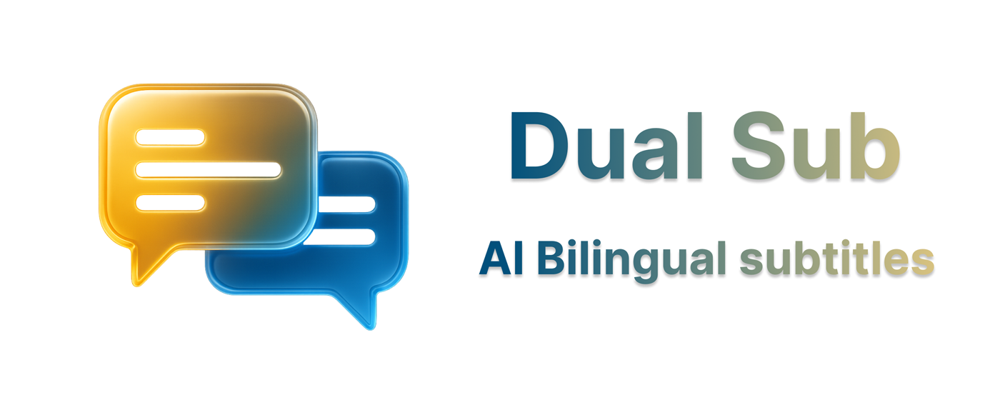

# DualSub

  

[English](README.md)

DualSub 是一个 Chrome 扩展，在 Netflix 和 Disney+ 上同时显示两种语言的字幕：视频语言的原文，以及下面的翻译。点一下字幕里的单词，就能看到它的意思。DualSub 需要 Chrome 116 或更高版本，界面支持英语、西班牙语、日语、韩语以及简体和繁体中文。

## 安装

从 [Chrome 应用商店](https://chromewebstore.google.com/detail/dualsub/lnkcpcbpjbidpjdjnmjdllpkgpocaikj)安装 DualSub。如要改用发布版 ZIP，请参阅[安装说明](docs/zh/installation.md)。

## 开始使用

1. 安装后会打开欢迎页，语言已经选好。你可以在那里更改翻译语言。
2. 在 Netflix 或 Disney+ 上播放任意内容。上面是视频的语言，下面是你的语言；视频本来就是你的语言时只显示一行。
3. 点一下字幕里的单词。侧边栏会显示它的翻译和词典释义。面板中的 **用 AI 解释** 会通过你自己的 OpenAI 或 Gemini 密钥，说明这个词的用法。

观看时，Chrome 工具栏上的 DualSub 按钮可以为当前网站打开或关闭 DualSub，并更改你的语言、文字大小、时间和位置。其余设置都在设置页中。

## 文档

- [安装说明](docs/zh/installation.md)
- [设置](docs/zh/configuration.md)
- [翻译服务](docs/zh/providers.md)
- [查词与 AI 解释](docs/zh/ai-context.md)
- [隐私政策](PRIVACY_POLICY.md)（英文）

## 参与贡献

请在 [GitHub Issues](https://github.com/QuellaMC/DualSub/issues) 中报告问题或提出功能建议。构建 DualSub 并运行测试的方法见 [CONTRIBUTING.md](CONTRIBUTING.md)（英文）。每个版本的更改见 [CHANGELOG.md](CHANGELOG.md)（英文）。

## 许可证

DualSub 采用 [CC BY-NC-SA 4.0](LICENSE) 许可：你可以在署名并采用相同许可的前提下分享和改编，但不得用于商业目的。

DualSub 与 Netflix、Disney+ 没有关联。
